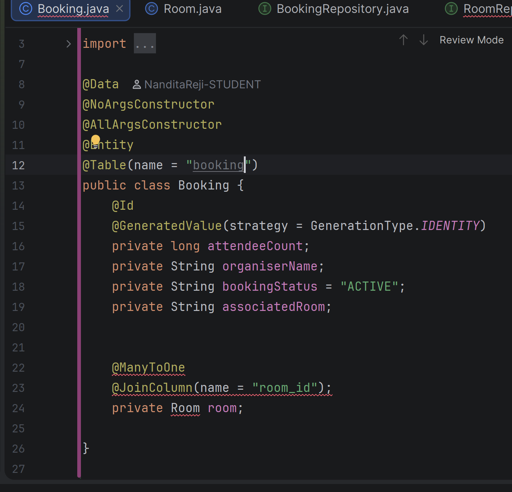
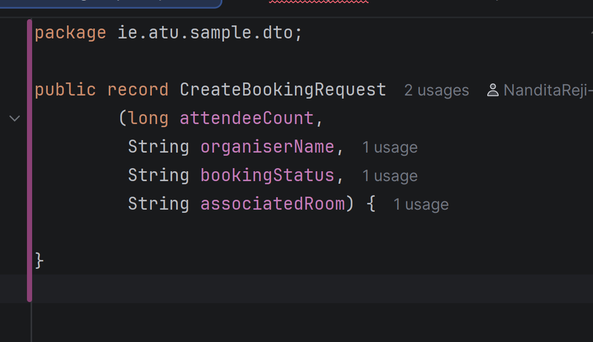
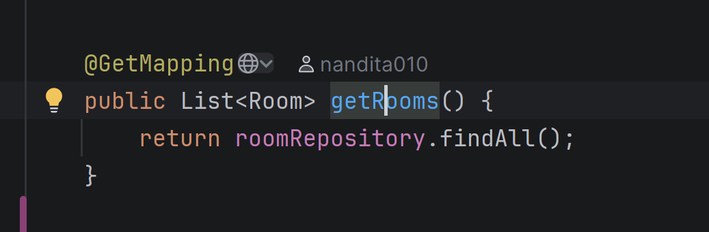
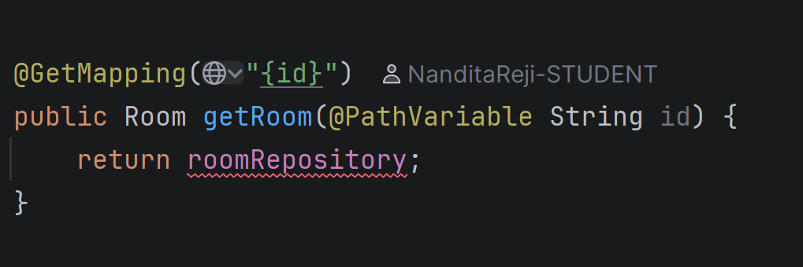
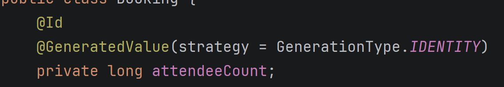
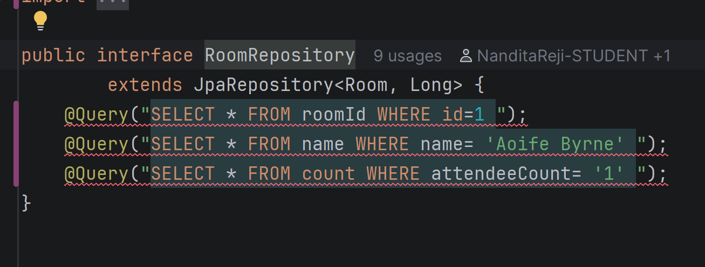

# CICD-1 Coding Test — Review, Improve and Reflect

**Student ID: G00463584**  
**Examination group:** A (Room Booking / JPQL)  
**Original examination pull-request URL (`exam-work`):https://github.com/nandita010/463584.git**  
**New review repository URL:https://github.com/nandita010/CIC1_Review_463584.git **

## 1. My original examination self-assessment

Review the code **as submitted in the original examination**.
Do not change the original repository, branch or pull request.
Check your own Group A or Group B examination paper and award marks only for evidence present in the original submission.

### Task 1 — 10/40
**My mark: 10**  
**Evidence from the original code (files, methods, working or missing requirements):**

### Task 2 — 10/40
**My mark: 10**  
**Evidence from the original code:**

### Task 3 — 4/20
**My mark: 4**  
**Evidence from the original code:**

**Total self-assessed original examination mark: 24/100**

**Checkpoint:** Commit this completed self-assessment as the **first review commit in your new repository**, before you modify or add application code. The lecturer decides the official original examination mark.

## 2. Corrections and improvements in my new project

Start from a **fresh copy of the starter template for your own exam group**, in a **new GitHub repository**. You may consult or selectively reuse your own original examination code, but the new project must demonstrate that you understand and can correct it. Do not change your original examination submission.

Describe **two or three important problems** in your original code. 
For each, explain what was wrong, which class or method you changed in the new project, 
and why the corrected approach works.

**Problem and correction 1:**
In Booking.Java, I realised this code is wrong as every booking needs its own unique ID no matter how many attendees are in it.

I corrected the @ManytoOne relationship with the room
**Problem and correction 2:**
I used SQL instead of JPQL and I put this piece of code in the wrong repository and it was meant to be in the
BookingRepository.java

In the review project I used the SQL in BookingRepository instead of the other repository.
**Problem and correction 3 (optional):**

## 3. API testing and evidence

Use Swagger UI or another HTTP client. For **at least four meaningful checks**, record the request/input, expected result, actual HTTP status/response, and pass/fail. Include unsuccessful cases; a running application alone is not enough.

**Test 1 — successful booking request:**
- Request / input:
  POST /api/bookings with roomId: 1,
- organiserName: Aoife Byrne 
- attendeeCount : 18.
- Expected: ACTIVE status must shown with 201
- Actual HTTP status / body: 201
- Pass / fail: Pass

**Test 2 — invalid input or excessive attendee count:**
- Request / input: POST /api/bookings,
- roomId 1,
- organiserName Aoife Byrne,
- attendeeCount 30
- Expected: 400 Bad request
- Actual HTTP status / body: 400 Bad Request
- Pass / fail: pass

**Test 3 — missing booking or room:**
- Request / input: GET /api/bookings/999
- Expected: 404 Not found
- Actual HTTP status / body:404 not Found
- Pass / fail: pass

**Test 4 — requirement specific to my group:**
- Request / input: GET /api/bookings/search?roomName=Lab%20201.
- Expected: 200 Ok
- Actual HTTP status / body: 404
- Pass / fail: fail

**Group A:** Demonstrate `GET /api/bookings/search?roomName=...` using an exact room name, bookings ordered by attendee count descending, and an empty list for no matches. Add checks if necessary to show all three behaviours.

**Group B:** Run the **provided** Room Service separately on port 8082 and the **new** Booking Service on port 8081. Demonstrate that booking creation obtains room details through OpenFeign and that booking retrieval uses the local Booking database. Do not modify the Room Service.

## 4. Reflection

**What did I understand during the examination but struggle to implement?**
I struggled to use JPQL  instead of SQL  and use the right methods within the repository
**Which Spring Boot, JPA, validation, JPQL or OpenFeign concept became clearer after correcting my code? Give a specific example.**

**What will I do differently in my next coding test or API development task?**
Recheck all my errors and work throught the errors
## Review lab assessment — 20 marks

- Honest original self-assessment with code evidence: **4 marks**
- Explanation of mistakes and Spring Boot concepts: **6 marks**
- Corrections in the new application: **4 marks**
- API testing and demonstration of understanding: **4 marks**
- Reflection and future improvement: **2 marks**

**Total: 20 marks.** Simply submitting a working solution does not demonstrate the learning required by this review.

## Proposed mark recovery — only if confirmed for CICD-1

If the same approach as OOP is adopted, the review could recover **up to 30% of marks lost** in the original examination, scaled by the review-lab mark.

**Marks recovered = (100 − official original exam mark) × 0.30 × (review lab mark ÷ 20)**

Example: exam **40/100** and review **16/20** → **14.4 recovered marks**, revised exam **54.4/100**. This is **not an approved CICD-1 policy unless confirmed by the lecturer**. The original official exam mark—not your self-awarded grade—is used in the calculation.

## Submission

Commit and push the **new review repository** with the completed README, corrected Spring Boot code and API-test evidence. Submit its GitHub URL on Moodle. **Do not push any changes to the original examination repository or `exam-work` pull request.**